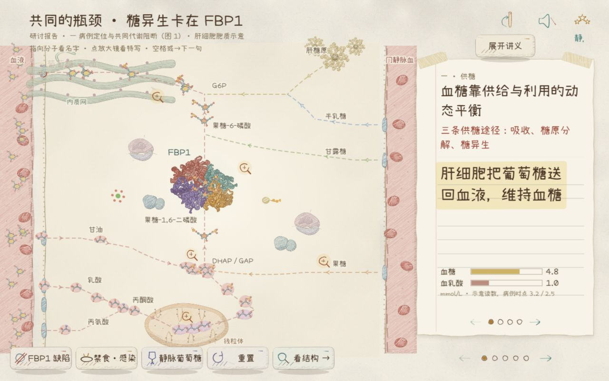

# Hand-drawn UI Lab

学习并构建有精细绘制、纸笔媒介感和自然交互的 Web UI。参考作品是 [Ballpoint Gambit](https://ballpoint-gambit.vercel.app/)；本仓库保留其客户端研究样本、原创绘图工具和交互实验。

远程仓库：[Shrimpaste/hand-drawn-ui-lab](https://github.com/Shrimpaste/hand-drawn-ui-lab)，当前为私有，默认分支 `main`。完整提交历史与 `baseline/*` 阶段标签同步保留。

目标是把这套语言用于各种场景、编辑器、仪表盘与 SaaS。角色、棋盘和庭院只是研究样本，不是新项目的固定模板。手绘风格靠对象完成度、颜料层次、真实笔迹、连续动作和接触反馈共同成立；米色背景、粗糙边框、手写字体不能代替这些工作。

**当前原创完成度参考是迁入的 bio-showcase Block 与 Room。** 用户于 2026-10-09 明确指出本地原创实验不及 bio 最终成果；Gallery 保留为机制实验，不再作为最高质量标杆。两页源码、共享引擎、字体和结构输入独立保存在 `experiments/bio/`；[源码研究与使用说明](docs/BIO_EXPERIMENTS.md) 记录迁入范围、适配和已知限制。

## 先读什么

| 文档                                     | 用途                                                                     |
| ---------------------------------------- | ------------------------------------------------------------------------ |
| [风格构建指南](docs/STYLE_GUIDE.md)      | 必读。把多轮人工纠正转为美术、动作和 UI 的设计方法，并给出 SaaS 转译示例 |
| [实现与迁移](docs/IMPLEMENTATION.md)     | 现有工具接口、实现顺序、可中断动画、DOM/SVG/Canvas 的选择                |
| [人工审核与迭代](docs/REVIEW_HISTORY.md) | 哪些方向曾失败、原因是什么、对应哪个提交；防止重复走弯路                 |
| [源码研究](docs/REFERENCE_STUDY.md)      | 原站绘制结构、十二套动作、真实颜色数据与本地适配边界                     |
| [Bio 原创实验](docs/BIO_EXPERIMENTS.md) | Block/Room 入口、源码机制、迁入快照、生成流程与质量定位 |
| [仓库结构](docs/ARCHITECTURE.md)         | 原作样本、自绘工具、场景定制、历史兼容模块的边界                         |
| [验证](docs/VALIDATION.md)               | 当前验证结果，以及动态、视觉、交互、声音分别怎样检查                     |
| [来源与使用边界](docs/PROVENANCE.md)     | 哪些文件来自原作，哪些是本地编写，哪些尚无再发布授权                     |

接手的 agent 从 [AGENTS.md](AGENTS.md) 开始。不要只看 Gallery 截图就开始复刻。

## 本地运行

使用 Node.js 22 或更新版本；当前在 Node.js 24.13.0 上验证。

```sh
npm ci
npm start
```

服务默认只监听 `127.0.0.1:5184`。它是静态服务器，修改文件后需要刷新页面。

| 地址                                                                                        | 当前用途                                                               |
| ------------------------------------------------------------------------------------------- | ---------------------------------------------------------------------- |
| [Bio Block](http://127.0.0.1:5184/experiments/bio/block.html) | 当前原创参考：共同代谢瓶颈、碳流、病况切换与反应特写 |
| [Bio Room](http://127.0.0.1:5184/experiments/bio/room.html) | 当前原创参考：FBP1 结构、拖动旋转、位点、水解、AMP 与突变 |
| [Gallery](http://127.0.0.1:5184/demos/gallery.html) / [Lab](http://127.0.0.1:5184/lab.html) | 同一个原创庭院：空间、物件交互、三种步态、逐笔开场、擦除重绘、极简选项 |
| [绘制小样](http://127.0.0.1:5184/scenes/studio.html)                                        | 局部笔触、固定/活轮廓、手写、Foley 的检查台                            |
| [Reference](http://127.0.0.1:5184/)                                                         | 原图集和原动作的最小还原，没有完整棋类规则                             |
| [Characters](http://127.0.0.1:5184/components.html)                                         | 十二个原角色的部件、睡眠、紧张与简化搬运实验                           |
| [中文字样](http://127.0.0.1:5184/demos/chinese-type.html) / [双字体](http://127.0.0.1:5184/demos/chinese-pair.html) / [笔迹](http://127.0.0.1:5184/demos/chinese-ink.html) / [便笺](http://127.0.0.1:5184/demos/chinese-notes.html) | 小赖与悠哉实页对照、三字体字样、有序笔画写擦和便笺组合；[说明](docs/CHINESE_TYPE.md) |

旧 `/demos/motion.html` 只重定向到 Gallery。Notebook 及早期材质代码保留为兼容实验，不能作为当前风格质量标杆。阁楼已移除。

```sh
npm test
```

当前 188 项测试通过（原实验 55 + Bio 133，其中 1 项是本次状态同步回归）。`npm run test:bio` 单独跑迁入测试，`npm run check:bio` 检查源码快照和依赖闭包。Bio 无需构建即可由同一静态服务器运行；`npm run bio:structure` / `npm run bio:font` 分别重建结构数据/字体子集。绘制小样可切换三种参观者，在同一冻结姿态下比较完整三稿，再对照连续动作。自动测试验证连续性、状态和绘制算法；美术完成度与听感需要看实际画面、操作并试听。当前证据及窄屏限制见 [验证文档](docs/VALIDATION.md)。



## 用于另一个项目

先依据目标功能设计一套原创对象与笔迹，再选用 `primitives/` 的能力。为每个交互写清楚“用户想做什么、对象如何回应、状态留下什么痕迹”；沿参考源码理解动作关系，然后实现适合新对象的轨道。不要把蘑菇、蚂蚁、棋盘或庭院直接当成 SaaS 组件需求。

原作动作模块与图集仍包含在研究仓库内；原创 Gallery 也直接使用原作求解器和部分反应轨道。它不是完全独立、可直接商用的开源组件包。迁移到公开或商业项目前，请按 [来源文档](docs/PROVENANCE.md) 区分学习方法、自绘实现与原作者内容。

Bio 两页使用自己的引擎，不导入上述 vendor/原图集；外部 PDB、字体与教学内容仍须按各自来源处理。两页使用字体裁切和正文逐字过渡，不能称为真实中文笔顺；窄屏保留整页缩放与横屏提示。

## 版本维护

代码与文档在本地提交后同步远程；阶段基线使用 `baseline/*` 标签。新工作分支使用 `codex/` 前缀。旧说明、截图和测试快照已从当前树收束，仍能在历史提交中恢复，参见 [审核记录](docs/REVIEW_HISTORY.md)。

新增能力时更新对应实现入口和风格规则；新验证替换当前记录，不累积一组互相冲突的 `final-v2` 文档。仓库不含原作者绘图生成器，也未声明覆盖原作内容的开源许可证。
