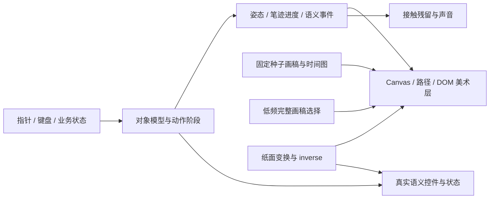

# 当前仓库结构

三层是来源/复用边界，不是强制目录迁移：原作研究样本、可组合的自绘工具、验证方法的原创场景。代码保留历史 URL；当前产品入口见 [README](../README.md)。

2026-10-09 起，原创层新增 `experiments/bio/` 的 Block/Room 源码副本，作为用户指定的较高完成度参考。它使用独立引擎与领域数据，不强行改造成 `primitives/` / `SceneHost` 的消费者；旧 Gallery 不再代表当前最高原创质量。机制与运行范围见 [Bio 实验](BIO_EXPERIMENTS.md)。

## 数据流

纹理、轮廓变体、连续姿态互相独立；主动作、余韵与声音共享事件。当前具体 Gallery 使用 Canvas + DOM 操作区，未来 SaaS 可改变渲染方式。

## 目录边界

| 文件/目录                                                    | 内容与来源                                                  | 如何使用                                        |
| ------------------------------------------------------------ | ----------------------------------------------------------- | ----------------------------------------------- |
| `src/vendor/reference-motion.js`                             | 从公开客户端提取的原作者求解器、idle、时间线及六类 animator | 研究样本；保持不改，不能冒充原创通用库          |
| `assets/{chars,board,world,text,paper}/`                     | 原角色 rig、图集、时间图、纸与文字压力表                    | 原作样本使用，独立原创画稿不引用                |
| `src/{main,model,character,atlas}.js`                        | 本地自由走格模型、原动作 adapter、Canvas 原图集渲染         | Reference 入口；不含完整游戏逻辑                |
| `src/components.js`                                          | 十二角色/部件/动作实验与简化蚂蚁搬运                        | 用来理解动作结构、相对角度与来源                |
| `src/{ink,paper-motion,illustrated-control,feedback}.js`     | 参考时间图/纸面/选项/残留 adapter                           | 部分通用能力已转到 primitives，原图集依赖仍保留 |
| `src/sketch-link.js`                                         | 参考页共享自绘导航与标签                                    | 与原创页共用简笔语言                            |
| `primitives/`                                                | 自绘、笔迹、时间图、动作事件、纸面、残留、Foley             | 可组合工具；适配宿主而不是强制框架              |
| `scenes/`                                                    | 庭院、自绘画稿、空间、对象状态、原求解器 adapter            | 原创演示与定制模型；不要全部迁移到 SaaS         |
| `experiments/bio/{block,room}.html` / `src/` | 两个源项目页面及其独立 engine/engine3d、场景、内容、结构 JSON 的依赖闭包 | 当前原创完成度参考；与旧场景并存，源码单独维护 |
| `experiments/bio/{public,references,scripts,tests}/` | 字体/许可、完整源字体、三份 PDB、字体/结构生成器与 20 份源测试 | 可在干净 clone 中运行、重建；无原大厅和报告文件 |
| `experiments/bio/source-manifest.json` / `scripts/check-bio-import.mjs` | 来源提交、逐文件哈希、适配记录 / 导入与资源闭包检查 | 追溯复制边界；后续变化需同步记录 |
| `demos/gallery.html` / `lab.html`                            | 都加载 `scenes/gallery.js`                                  | 当前同一画廊入口                                |
| `demos/chinese-{type,pair,ink,notes}.html`                    | 字体对照、双字体实页、笔画试验、便笺组合；共享 `chinese-type.js/css` | 独立中文测试页，不改变 Gallery               |
| `primitives/chinese-handwriting.js` / `generated-chinese-medians.js` | 本地绘制和可逆游标 / Hanzi Writer Data 生成的笔画中线 | 数据受 Arphic PL 约束，见来源文档               |
| `fonts/`                                                     | 三款完整网页字体、OFL 文件、笔画数据许可与来源清单             | 静态字形和动态中线分开使用                       |
| `scenes/studio.html` / `scenes/studio.js`                    | 原创局部绘制、轮廓、书写和声音小样                          | 局部艺术/算法检查，不是产品布局模板             |
| `primitives/drawing-variants.js` | 人工配置的完整三稿形变场、保护局部支点，供 Pencil 烘焙 | 可选局部重画；不负责运行时位移或业务状态 |
| `demos/notebook* / runtime.js / art.js / material-motion.js` | 早期工具与兼容实验，部分仍被 tests 读取                     | 历史质量不足，不能作为当前风格标杆              |
| `demos/motion.html`                                          | 已移除阁楼的旧 URL 重定向                                   | 仅兼容；没有活动 attic 场景                     |
| `research/`                                                  | 精简后的来源事实与一份当前验证                              | 不由本地服务器公开服务，旧记录在 Git 历史       |
| `scripts/`                                                   | 静态服务器、来源依赖提取、动作审计、离线声音试听            | 用途与限制见下面                                |
| `tests/`                                                     | 模型、原图集适配、笔迹、时间图、连续性、状态与材料音        | 不代替人工美术/听感审核                         |

## 原创 Gallery 的职责

| 模块                                                                  | 职责                                                               |
| --------------------------------------------------------------------- | ------------------------------------------------------------------ |
| `host.js`                                                             | Canvas 尺寸/DPR、纸面与逆变换、DOM 控件、选项写擦、开场、RAF、音频 |
| `gallery.js`                                                          | 展览场景编排、作品聚焦、控件、前景标签、角色替换、对象/音效事件    |
| `gallery-model.js`                                                    | 行走、作品进出、坐凳生命周期和完整可见姿态                         |
| `courtyard-layout.js`, `courtyard.js`                                 | 地面投影、展位与道具落点、层级和构图                               |
| `courtyard-details.js`, `courtyard-ornaments.js`, `courtyard-life.js` | 细节画稿、天空/地面装饰、灯/水/植物等微交互                        |
| `bench-path.js`                                                       | 避开完整凳子 footprint 的路由与不可达结果                          |
| `guide.js`, `visitor-art.js`                                          | 独立自绘蘑菇/兔子/猫头鹰画稿与细节                                 |
| `guide-rig.js`, `guide-render-pose.js`                                | 锚点、父子结构、spring 与画稿相对角度适配                          |
| `guide-motion.js`                                                     | **直接使用原作 Puppet 和部分 pawn 反应**，加入本地连续动作         |
| `visitor-locomotion.js`, `visitor-reactions.js`, `visitor-redraw.js`  | 分物种位移/姿态/接触、局部反应适配、旧画擦除新画绘制               |

Gallery 的美术自绘不等于动画运行时完全原创。[来源清单](PROVENANCE.md) 对二次构建很重要。

## 工具与数据

- `scripts/serve.mjs`：只监听本地；屏蔽点目录、node_modules、research 和向上路径；无热更新。
- Bio 页面由同一服务器直接加载原生模块（含 JSON import attributes），HTML 单独加载 CSS；根依赖增加 Vitest 与 subset-font，分别负责原测试和字体重建，运行时不依赖 Vite。
- `scripts/build-chinese-medians.mjs`：从固定版本 `hanzi-writer-data` 提取测试页和样文的有序中线；`npm run hanzi` 重建生成文件与 Arphic PL 全文。
- `scripts/audit-characters.mjs`：读取本地 vendor 与十二 rig，重建 `research/character-motion-audit.json`。它是来源机制记录，不是视觉验收。
- `scripts/extract-motion.mjs`：历史提取工具，需要未入 Git 的 `research/reference.pretty.js`，会重写 vendor；普通开发不要运行，干净 clone 也不能直接重新提取完整原客户端。
- `scripts/render-foley.mjs`：生成离线声音试听到 research。产物忽略，不覆盖当前 Gallery 验证结论。
- `research/reference-pigments.json`：局部颜色测量；`asset-inventory.json`：当时浏览器观察的原资源；`motion-extraction.json`：依赖闭包映射。
- `research/current-validation.json`：当前 Bio 验证与明确标日期的既有 Gallery/中文字样基线；本轮图为 `bio-block.jpg` / `bio-room.jpg`，范围/限制见 [验证](VALIDATION.md)。

需要旧说明、失败原型或删除阁楼时从 [审核记录](REVIEW_HISTORY.md) 对应标签读取；不要恢复成与当前指南并列的活动指令。
